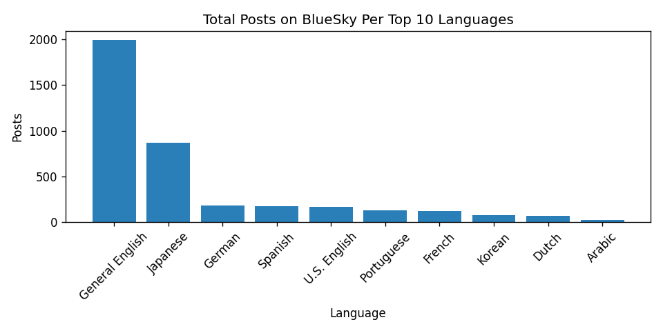

# BlueSky Stream Ingestion Project

**Author:** Rachel

**DS 3022 Data Project 3, Fall 2026**

## Data source

Source:

Name --> BlueSky

URL --> wss://jetstream2.us-east.bsky.network/subscribe?wantedCollections=app.bsky.feed.post

Method --> Websocket (push)

**For more information about source, check SOURCE_CARD.md. 


## How to run


1. Setting up

i. Install Docker:
```bash
docker run hello-world
```

ii. Starting cluster
```bash
docker compose up -d
docker exec -it redpanda-0 rpk cluster info
```

iii. Set up your environment within 4 terminals (T1-T4)
```bash
python3 -m venv .venv && source .venv/bin/activate # macOS / Linux
py -m venv .venv ; .venv\Scripts\Activate.ps1 # Windows (PowerShell)
pip install -r requirements.txt
pip install prefect matplotlib
```

3. Create the topic
Within T4:
```bash
docker exec -it redpanda-0 rpk topic create bluesky-posts -p 3 -r 3
docker exec -it redpanda-0 rpk topic describe bluesky-posts
```

4. Running producer and lander

i. Within T1:
```bash
cd project3
python producer.py
```
ii. Within T2:
```bash
cd project3
python lander.py
```
5. Running flow

i. Start Prefect
``` bash
prefect config set PREFECT_API_URL=http://127.0.0.1:4200/api
prefect server start
```

ii. Full data run

Within T3:
```bash
cd project3
python flow.py
```

iii. Sample data run

Within T4:
```bash
cd project3
python flow.py data/sample
```

## Architecture


## Design decisions

Answer each in 2-4 sentences, in your own words, with your own numbers.

1. **Key and partitions.** 

The 'did' key is appropriate for stream integration of BlueSky posts because it groups user data together, even when they have multiple posts throughout time. Additionally, every user receives a unique, immutable did:plc or did:web which means that even when a user changes their name, it's reference in did is unchanged. This also distributes different users across the topic’s three partitions.

2. **Batch size and time.**

The lander continues to write within a Parquet file when either 1,000 records are reached or 60 seconds have gone by. The measured rate of records per second is 54.32, meaning 1000 records takes roughly 18.40 seconds, so it is more likely to stop based on the batch size. Within an hour, the number of files in is 196.


3. **Offsets after the file.** 

The lander writes to the Parquret file first, then stores the offsets. When the lander craches after writing a file, but before storing offsets, the program has an at-least-once delivery structure where records would not be lost as Kafka still considers the records unfinished, and on restart, the lander reads them again. This means that it is subject to duplicates, but never missing records in this scenario. Later, the flow deletes duplicates so no records are missing or redundant. 

```bash
if full or old:
    path = write_batch(rows) #first writing the file
    print(f"Landed {len(rows):4d} records -> {path}")
    if CRASH_AFTER_WRITE:
        print("CRASH (on purpose): the file exists, the offsets were NOT stored")
        os._exit(1)
    for m in last.values():
        consumer.store_offsets(message=m) #now offset storage
    rows, last = [], {}
```

4. **Duplicates.** 
Kafka records are identified by it's partition and it's offset. If a lander writes the same record, it will have these same values. This is removed in stage function of the flow.py. 

```bash
SELECT DISTINCT * EXCLUDE (landed_at)
```

Another type of duplicate is having the same BlueSky post which are identitifed by did and rkey. This is removed in the entities function of the flow.py. 

```bash
PARTITION BY did, rkey
ORDER BY time_us DESC, kafka_offset DESC
```

5. **Windows and time.** 

I use event time (time_us) in my first chart function's analysis with a window size of an hour because originally I wanted to know about the hourly change in post creations. I ended up changing my final chart in chart2 function to not include time as a variable because I wanted to use live data collection, but not run my program for hours. 


6. **Ten times the volume.** 

At ten times the rate, I would collect 543 records per second (54.32*10) and therefore it would stop collecting within 1.8 seconds for each file as 1000/543 = 1.8. Within one hour, I would have 1,955 files created which is a lot for my program to scan through. I would therefore want to increase the batch size to 5-10,000 records per file so that three partitions would still work. 

## Chaos round


| Card | Prediction | What I did | Numbers before → after | Explanation |
|---|---|---|---|---|
| D1 Crash between file and offsets | Raw will increase. | I stopped the lander, waited for the records to accumulate, ran python lander.py crash, then restarted the lander normally and ran the flow. | raw 6,476, malformed 0, unique Kafka records 6,476, unique posts 6,308 -> raw 11,762, malformed 1, unique Kafka records 10,761, unique posts 10,493 | The lander writes the Parquet file before storing Kafka offsets. When it crashed after writing, Kafka did not consider those records complete, so they were read again after restart. This increased the raw count, while SELECT DISTINCT removed repeated copies of the same Kafka records. The malformed count also increased by one, so this run appears to include the poison-message test as well. |
| D2 Poison message | Raw and malformed will each go up by 1. | I sent an invalid JSON message to the Kafka topic, but the counts did not change after the flow run. | raw 11,762, malformed 1, unique Kafka records 10,761, unique posts 10,493 -> raw 11,762, malformed 1, unique Kafka records 10,761, unique posts 10,493 | This attempt did not provide evidence that the poison message reached a completed Parquet batch. The expected successful result would be raw records increasing by one and malformed records increasing by one, while unique Kafka records and unique posts stayed unchanged. |
| D5: Send it all again | Nothing will be lost. | I sent records from an already captured period again and ran the flow after the lander wrote them. | raw 11,762, malformed 1, unique Kafka records 10,761, unique posts 10,493 -> raw 19,582, malformed 1, unique Kafka records 18,581, unique posts 18,105 | These records received new Kafka offsets, so they counted as new Kafka records and increased both the raw and unique-Kafka-record totals. However, some represented posts already present in the dataset, so the did + rkey entity deduplication prevented all of them from becoming additional unique posts. |

## The four numbers

From the flow log on the full data (screenshot in `docs/`):

| Number | Full data | Sample (`data/sample`) |
|---|---:|---:|
| Raw records landed | 54582 | 5000 |
| Malformed (kept in raw) | 1 | 0 |
| Unique Kafka records | 52721 | 4927 |
| Unique posts | 52186 | 4925 |

## Challenges / Obstacles

One challenge I had was adapting my producer from the Earthquake example to the BlueSky producer. I made sure to thoroghly review the slides and guided worksheets, asked my professor clarifing questions about whether to keep the history function, and consulted with peers on how they approached the editting process. Another difficultly with now specifically BlueSky is that there are posts that do not contain complete information (e.g. lang is NUll). This was then handled in the lander.py by setting langs to either the language offered or None (i.e. langs = r.get("langs") or [None]) and also in the chart function in flow.py with the SQL query containing WHERE lang IS NOT NULL. The flow kept those records in the raw and cleaned post tables, but now the chart exclubed the null languages so it could create a clearer visualization that is not misleading. 


## Analysis

My research question is which languages have the most BlueSky posts in the captured dataset. I thus created a chart that showed the ten most common languages given the posts I collected, and the sample of those posts. I found that general English, labelled as 'en', had by far the highest count of posts, followed by Japanese ('ja'), and then Spanish ('es'). I know that my results show the unique posts/Kafka records because the flow removes duplicates. One limitation was that there were several records with no language value, and we don't know if that information would have changed these results. In my other chart, where I explored the distribution of posts across several hours within a day and separated it by language, I found that the distribution differed widely across the hours for all the languages. I believe this is because the amount of time I ran my program. Because I didn't want to run the program for several hours, and I was committed to using only live captured data, I switched my analysis question to the one above. 


## Plot / Visualization



## Reflection


This project I first learned more about what a Kafka record is and how duplicates worked.  A record can be written to Kafka, landed in a Parquet file, deduplicated in DuckDB, and still represent the same post as another record. I then learned why storing offsets after writing the file gives at-least-once delivery as a crash can create duplicates, but it avoids losing records. And that these duplicates can be easily cleaned up later. I also learned that raw data and final analysis data should be kept separate, because malformed messages can be preserved for inspection while being excluded from clean tables. If I could started again, I would plan the capture period more carefully so the event-time chart covered a continuous period and be able to show complete, meaningfl data.


## Acknowledgements

I heavily used the guided worksheets and slides to help guide me in my adaptation of this project for BlueSky. I also made sure to come with questions for the professor when we had class when I was confused by instructions. I also seeked advice from my peers and had peer evaluations for my project. Liana was my peer evaluator and noticed that I didn't commit requirements.txt and within my README, I didn't specify to start prefect dashboard. I have since added them to my project to ensure it is easy to follow along and replicate my results. 

