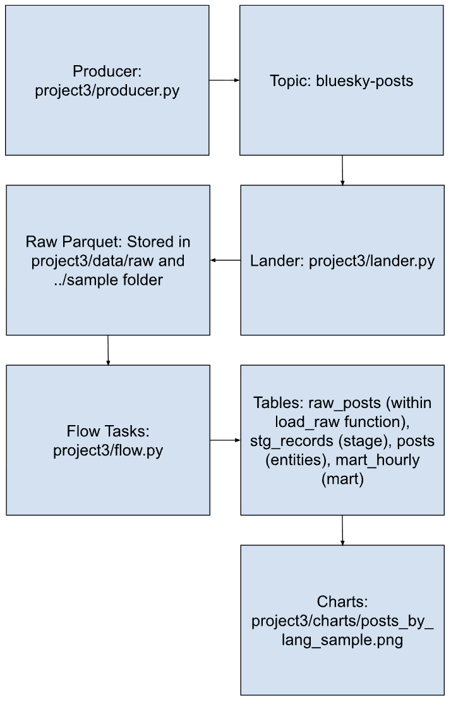

# BlueSky Stream Ingestion Project

**Author:** Rachel

**DS 3022 Data Project 3, Fall 2026**

## Data source

_(replace: what source, which URL or stream, pull or push, what one message contains. Mention any account, key or User-Agent needed. If you replay an archive rather than stream live, say so.)_

Source:

Name --> BlueSky

URL --> wss://jetstream2.us-east.bsky.network/subscribe?wantedCollections=app.bsky.feed.post

Method --> Websocket (push)

**For more information about source, check SOURCE_CARD.md. 


## How to run

_(replace: the exact commands, in order, from a fresh clone. A classmate will follow them in Session 4 (Mon 16 Nov) without asking you. Include: virtual environment and `pip install`, starting the cluster, creating the topic, running the producer and lander, running the flow on the full data and on the sample:)_


1. Setting up

i. Install Docker:
```bash
docker run hello-world
```

ii. Starting cluster
```bash
docker compose up -d
docker exec -it redpanda-0 rpk cluster info
```

iii. Set up your environment within 4 terminals (T1-T4)
```bash
python3 -m venv .venv && source .venv/bin/activate # macOS / Linux
py -m venv .venv ; .venv\Scripts\Activate.ps1 # Windows (PowerShell)
pip install -r requirements.txt
pip install prefect matplotlib
```

3. Create the topic
Within T4:
```bash
docker exec -it redpanda-0 rpk topic create bluesky-posts -p 3 -r 3
docker exec -it redpanda-0 rpk topic describe bluesky-posts
```


4. Running producer and lander
i. Within T1:
```bash
cd project3
python producer.py
python lander.py
python four_numbers.py did,rkey
```
ii. Within T2:
```bash
cd project3
python lander.py
```
5. Running flow

i. Full data run
Within T3:
```bash
cd project3
python flow.py
```

ii. Sample data run
Within T4:
```bash
cd project3
python flow.py data/sample
```

## Architecture

_(replace: a diagram (an image in docs/ or a text diagram) of producer → topic → lander → raw Parquet → flow tasks → tables → charts, with the names of your files, topic, tables and charts.)_



## Design decisions

Answer each in 2-4 sentences, in your own words, with your own numbers.

1. **Key and partitions.** 

The 'did' key is appropriate for stream integration of BlueSky posts because it groups user data together, even when they have multiple posts throughout time. Additionally, every user receives a unique, immutable did:plc or did:web which means that even when a user changes their name, it's reference in did is unchanged. This also distributes different users across the topic’s three partitions.

2. **Batch size and time.**
The lander continues to write within a Parquet file when either 1,000 records are reached or 60 seconds have gone by. The measured rate of records per second is 54.32, meaning 1000 records takes roughly 18.40 seconds, so it is more likely to stop based on the batch size. Within an hour, the number of files in is 196.


3. **Offsets after the file.** 
The lander writes to the Parquret file first, then stores the offsets. When the lander craches after writing a file, but before storing offsets, the program has an at-least-once delivery structure where records would not be lost as Kafka still considers the records unfinished, and on restart, the lander reads them again. This means that it is subject to duplicates, but never missing records in this scenario. Later, the flow deletes duplicates so no records are missing or redundant. 

```bash
if full or old:
    path = write_batch(rows) #first writing the file
    print(f"Landed {len(rows):4d} records -> {path}")
    if CRASH_AFTER_WRITE:
        print("CRASH (on purpose): the file exists, the offsets were NOT stored")
        os._exit(1)
    for m in last.values():
        consumer.store_offsets(message=m) #now offset storage
    rows, last = [], {}
```

4. **Duplicates.** 
Kafka records are identified by it's partition and it's offset. If a lander writes the same record, it will have these same values. This is removed in stage function of the flow.py. 

```bash
SELECT DISTINCT * EXCLUDE (landed_at)
```

Another type of duplicate is having the same BlueSky post which are identitifed by did and rkey. This is removed in the entities function of the flow.py. 

```bash
PARTITION BY did, rkey
ORDER BY time_us DESC, kafka_offset DESC
```

5. **Windows and time.** 


_(replace: which time column your analysis uses (event time or landing time), which window size, and why.)_
6. **Ten times the volume.** _(replace: what in your pipeline would break or slow down first at 10x your rate, and what you would change.)_

## Chaos round


| Card | Prediction | What I did | Numbers before → after | Explanation |
|---|---|---|---|---|
| D1 Crash between file and offsets | Raw will increase. | TODO| raw 6,476, malformed 0, unique Kafka records 6,476, unique did+rkey 6,308  -> raw 11,762, malformed 1,unique Kafka records 10,761, unique did+rkey 10,493 | TODO |
| D2 Poison message | Raw and malformed will each go up by 1. | TODO | raw 11,762, malformed 1, unique Kafka records 10,761, unique did+rkey 10,493 ->  raw 11,762, malformed 1, unique Kafka records 10,761, unique did+rkey 10,493 | TODO |
| TODO (D3, D4 or D5) | Nothing will be lost. | TODO | raw 11,762, malformed 1, unique Kafka records 10,761, unique did+rkey 10,493 -> raw 19,582, malformed 1, unique Kafka records 18,581, unique did+rkey 18,105 | TODO |

## The four numbers

From the flow log on the full data (screenshot in `docs/`):

| Number | Full data | Sample (`data/sample`) |
|---|---:|---:|
| Raw records landed | 54582 | 5000 |
| Malformed (kept in raw) | 1 | 0 |
| Unique Kafka records | 52721 | 4915 |
| Unique TODO (your entity) | 52186 | 4910 |

## Challenges / Obstacles

_(replace: what this source made hard in gathering, processing and analysis, and how you worked through it. What methods and tools did you use?)_

## Analysis

_(replace: one clear paragraph. Your research question, what the data shows, one finding that surprised you or is not obvious, and one limitation of your data or method.)_

## Plot / Visualization

_(replace: at least one chart, saved in charts/ and shown here. Give it a title and labelled axes with units.)_


## Reflection

_(replace: about 150 words, first person. What did you learn about streaming systems that you did not know before Thu 22 Oct? What would you do differently if you started again?)_

## Acknowledgements

_(replace: everyone who helped you and how (classmates, instructor, online sources), code you reused (for example connection code from probe.py), and any AI assistance: what for, and how you checked the result. Write "None" if there is nothing to declare.)_
